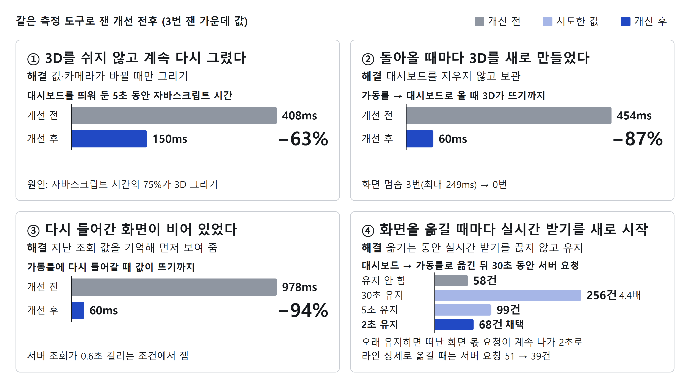

# 성능 검토와 개선 — 화면 전환 속도와 실시간 데이터

> "데이터는 실시간으로 들어오는데 화면을 옮길 때 느려지거나 로딩이 길다"(2026-11-20)에 대한 검토와 개선 기록.
> 무엇이 문제였고(3장), 어떻게 고쳤고(4장), 결과가 어떤지(5장)를 같은 측정 도구(`npm run perf`)로 잰 숫자로 남긴다.
> 결정 로그 D-120. 측정한 숫자와 코드를 읽고 추정한 숫자를 나눠 적는다.

## 변경이력
| 날짜 | 내용 |
|---|---|
| 2026-11-20 | 초안: 측정 결과, 원인 4가지, 해결 순서 |
| 2026-11-21 | feat/vue-base를 fix/1121-shift-demo까지 앞당김(팀원 작업 25개) |
| 2026-11-21 | 측정 도구(`npm run perf`) 추가, 개선 1~4 적용, 전후 결과 (D-120) |
| 2026-11-22 | 7장 발표용 한 페이지(트러블슈팅)와 설명 이미지 추가 |

---

## 1. 요약

화면 전환 때 버벅임과 대시보드의 상시 부담은 크게 줄었다. 실서버 요청 수는 같은 구독을 쓰는 화면 사이에서만 줄었고, 나머지는 백엔드 API가 바뀌어야 줄어든다.

| 문제 | 개선 전 | 개선 후 | 고친 것 |
|---|---:|---:|---|
| 대시보드를 띄워 두기만 해도 드는 자바스크립트 시간 (5초) | 408ms | 150ms (−63%) | 개선 1 |
| 다른 화면 → 대시보드: 3D가 뜨기까지 | 454ms | 60ms (−87%) | 개선 2 |
| 다른 화면 → 대시보드: 멈춤(50ms 넘는 긴 작업) | 3번, 가장 긴 것 249ms | 0번 | 개선 2 |
| 다시 들어간 화면이 값을 보이기까지 (조회 600ms 지연 조건) | 978ms | 60ms (−94%) | 개선 4 |
| 대시보드 → 라인 상세 이동 때 실서버 요청 (2초 안) | 51건 | 39건 (−24%) | 개선 3 |
| 18번 오간 뒤 메모리 | 20.5MB | 14.7MB | 개선 2 (누수는 원래 없었음) |

- 숫자는 데모 데이터·소프트웨어 그리기 조건(2장)의 중앙값이다. 요청 수는 실서버 모드에서 서버 없이 센 수다.
- 바뀌지 않은 것: 대시보드를 띄워 둔 10초 동안 실서버 요청 79건. 구독마다 주기 조회를 하는 구조라 프론트만으로는 못 줄인다 (6장, 백엔드 요청).
- 대가: 같은 구독을 안 쓰는 화면으로 옮기면 떠난 대시보드 몫 구독이 2초 더 돌아, 떠난 뒤 30초 동안 요청이 58 → 68건 (+10건).

## 2. 측정 방법

`npm run perf -- --label 이름` 하나로 같은 조건을 다시 만든다 (`scripts/perf/measure.mjs`).

| 항목 | 조건 |
|---|---|
| 빌드 | 실제 배포와 같은 빌드(`vite build` + `vite preview`). 개발 서버는 화면 전환 시간이 실제와 달라 쓰지 않는다 |
| 데이터 | 데모 데이터(mock). 서버 없이 같은 값이 나온다 |
| 브라우저 | 설치된 Chrome (Playwright로 조작), 창 1920×940, 시나리오마다 새 창 |
| 3D 그리기 | 소프트웨어(SwiftShader). 어느 PC에서나 같은 조건이지만 **fps는 실제 PC보다 낮다.** 자바스크립트 시간은 실제와 비슷하다. 그래픽 카드로 재려면 `--gpu` |
| 반복 | 시나리오마다 3번, 가운데 값(중앙값) |
| 개선 전 재기 | 옛 커밋을 `git worktree`로 꺼내 `--root <폴더>`로 잰다 (측정 도구는 지금 것을 그대로) |
| 결과 | `docs/perf/<이름>.json`. 두 결과 비교 표는 `npm run perf -- --compare 개선전 개선후` |

| 시나리오 | 하는 일 | 재는 것 |
|---|---|---|
| 대시보드를 띄워 둔 5초 | 대시보드를 열고 4초 기다린 뒤 5초 동안 | 자바스크립트 시간, 브라우저 작업 시간, 50ms 넘는 긴 작업 수 (Chrome 성능 지표 `Performance.getMetrics`, `longtask`) |
| 가동률 → 대시보드 | 대시보드 → 가동률 → 상단 메뉴로 대시보드 | 3D 이름표가 뜨기까지 시간, 그 뒤 2초 안 긴 작업 수·최대·합 |
| 가동률 다시 들어가기 | 데모 조회를 일부러 600ms 늦춘 빌드(`VITE_MOCK_DELAY_MS=600`)에서 가동률에 두 번 들어감 | 값(표의 줄)이 뜨기까지 시간: 처음 · 다시 |
| 실서버 모드 요청 수 | 실서버 모드 빌드(`VITE_DATA_SOURCE=api`). 모든 `/api` 요청에 빈 응답을 주고 개수만 센다 (서버 없이) | 대시보드 10초 · 대시보드 → 라인 상세 · 대시보드 → 가동률 뒤 30초 합 · 오래 떠났다 돌아올 때 요청 수와 그중 실시간 구독 요청 |
| 18번 오가기 | 대시보드 ↔ 가동률 18번, 메모리 정리 후 | 힙, DOM 노드, 이벤트 리스너 (누수 확인) |

**프론트만으로 못 재는 것:** 실제 서버 응답 시간·서버 부하·사내 네트워크 지연(실서버에 붙여 브라우저 네트워크 탭으로), 실제 화면 fps(그래픽 카드가 있는 사무실 PC에서 `--gpu`).

## 3. 무엇이 문제였나

### 3.1 3D가 쉬는 동안에도 매 프레임 그렸다
`factory3d/scene.ts`의 `loop`가 `requestAnimationFrame`마다(초당 최대 60번) 아래를 모두 했다. 값은 1초에 한 번 바뀌는데 그리기는 그보다 수십 배 많았다.
- `paint()`: 설비 39대의 상태 색을 다시 칠하고, 설비마다 모든 부품을 돌며 발광색(고장 깜빡임)을 다시 넣음
- `drawBoxes()`: 제품 상자 전부의 위치를 다시 씀
- `placeTags()`: 이름표 약 150개의 화면 좌표를 다시 계산해 DOM에 씀. 매번 `clientWidth`를 읽어 레이아웃 계산이 끼어듦
- `renderer.render`: 그림자 지도(2048)까지 포함해 장면 전체를 그림

**확인:** 대시보드를 띄워 둔 5초를 CPU 프로필로 떠 보니, 자바스크립트 약 590ms 중 **약 75%가 three.js 그리기 자체**(재질 값 올리기·그리기 호출)였고, 우리 코드(`scene.ts`)는 약 12%였다. 그래서 "그리는 횟수"와 "한 번 그리는 비용"을 같이 줄여야 했다. 재질은 부품마다 복제해 1천 개가 넘어, 그릴 때마다 부품마다 재질 값을 다시 올리고 있었다.

### 3.2 대시보드에 들어갈 때마다 3D를 처음부터 다시 만들었다
화면을 떠나면 `Factory3D`가 장면을 버리고(`dispose`), 돌아오면 WebGL 준비 · 설비 모형 수백 개 생성 · 셰이더 준비를 다시 했다. 돌아올 때 긴 작업(멈춤) 3개, 가장 긴 것 약 250ms. 라인 상세 → 대시보드 화면 전환 효과(D-119)와 겹쳐 버벅임으로 보였고, 카메라 위치·고른 라인·탑뷰도 매번 처음으로 돌아갔다.

### 3.3 화면을 옮길 때마다 실시간 구독이 끊겼다 다시 열렸다
`useLiveSnapshot` · `useLiveSummary` · `useProductFlow`는 쓰는 곳 수를 세어 0이 되면 구독을 끊었다. 화면을 바꾸면 Vue가 옛 화면을 먼저 내리므로 그 사이 0이 되어 끊겼다가 새 화면이 바로 다시 열었다. 실서버 모드에서는 다시 열 때 첫 조회를 한꺼번에 보낸다 (상태 3건 · 요약 16건 · 3D 물류 2건). `useProductFlow`는 아예 쓰는 곳마다 구독을 따로 열었다.

### 3.4 주기 조회 화면은 들어갈 때마다 빈 값에서 시작했다
`usePoll`은 화면이 생길 때 값을 비우고 조회를 시작했다. 같은 화면에 다시 들어가도 응답이 올 때까지 "불러오는 중"이었다.

## 4. 어떻게 고쳤나

| 개선 | 한 일 | 커밋 · 파일 |
|---|---|---|
| 1. 3D를 필요할 때만 그리기 | 카메라가 움직이거나, 값·마우스·고장 깜빡임이 바뀌었을 때만 그린다 (`invalidate()`로 예약). 상자만 옮겨 갈 때는 초당 24번까지. 그림자 지도는 모형이 바뀔 때만 다시 그림. 재질은 설비·라인 묶음 안에서 같이 씀(복제 수 대폭 감소). 상태 색·이름표는 바뀐 것만 고치고, 같은 값이면 DOM을 건드리지 않음. 창 크기는 `ResizeObserver`에서만 읽음 | `89c4a5b` · `factory3d/scene.ts` |
| 2. 대시보드 보관 | `AppShell`의 `RouterView`를 `KeepAlive`로 감싸 대시보드만 보관. 떠나 있는 동안 3D 그리기를 멈추고(`pause`), 돌아오면 다시 켬(`resume`). 떠날 때 설비 팝업은 닫음 (11/22 main 합칠 때: 설비 다가가기·라인 상세 전환 효과가 빠져 카메라 되돌리기도 뺌). 3D 코드(three.js)는 첫 화면 뒤 한가할 때 미리 받음 | `a023ceb` · `layouts/AppShell.vue`, `Factory3D.vue` |
| 3. 구독 유지 | 실시간 구독을 `sharedLive`로 앱 전체가 하나 같이 쓰고, 쓰는 곳이 0이 되어도 **2초** 두었다가 끊음 (화면 전환 틈만 넘김). 보관된 대시보드는 떠나 있는 동안 쓰는 곳에서 빠짐. 3D 물류 구독도 하나로 | `c88102b` `c20704c` `14761ee` `ef1264f` · `composables/sharedLive.ts` 외 3개 |
| 4. 조회 값 기억 | `usePoll(load, 주기, key, cacheName)`: 조회마다 마지막 값을 기억(최대 60개)해, 다시 들어오면 지난 값을 먼저 보이고 뒤에서 새로 받음. 가동률·라인 상세·공정 상세·생산 조회·알람 이력·3D 배정·입고·검사·예지보전 이력에 적용. 보관된 대시보드의 주기 조회는 떠나 있는 동안 멈춤 | `c300460` `c20704c` · `composables/usePoll.ts` 외 10개 |

**고치면서 바로잡은 것** (측정이 잡아낸 부작용)
- 대시보드를 보관하자, 다른 화면에 가 있어도 대시보드 몫 구독(요약·3D 물류)과 주기 조회가 계속 돌았다 → 보관 중에는 쓰는 곳에서 빠지게 함 (`c20704c`).
- 구독 유지 시간을 처음엔 30초로 했더니, 대시보드에서 금방 돌아올 때 요청은 33 → 12로 줄었지만 **떠난 뒤 30초 동안 요청이 58 → 256으로 늘었다.** 유지 시간을 줄여 가며 쟀다 (5장 표). 유지는 화면 전환 틈만 넘기면 되므로 2초로 정했다.

**보이는 동작이 바뀐 것 (D-120):** 대시보드에서 다른 화면에 다녀오면 보던 보기(3D/탑뷰)와 고른 라인이 그대로 남는다. 다시 들어간 화면은 잠깐 지난 값을 보였다가 새 값으로 바뀐다.

## 5. 결과

**같은 조건 전후 비교** (`npm run perf -- --compare 개선전 개선후`, 결과 파일 `docs/perf/개선전.json` · `개선후.json`)

| 시나리오 | 지표 | 개선 전 (2747478) | 개선 후 (ef1264f) | 변화 |
|---|---|---:|---:|---:|
| 대시보드를 띄워 둔 5초 | 자바스크립트 시간(ms) | 408 | 150 | −63% |
|  | 브라우저 작업 시간(ms) | 508 | 284 | −44% |
|  | 긴 작업(50ms+) 수 | 0 | 0 | 0 |
| 가동률 → 대시보드 | 3D 이름표가 뜨기까지(ms) | 454 | 60 | −87% |
|  | 긴 작업 수 (2초 안) | 3 | 0 | −100% |
|  | 가장 긴 작업(ms) | 249 | 0 | −100% |
|  | 긴 작업 합(ms) | 415 | 0 | −100% |
| 가동률 다시 들어가기 (데모 조회 600ms 지연) | 처음 들어갈 때 값이 뜨기까지(ms) | 957 | 883 | −8% |
|  | 다시 들어갈 때 값이 뜨기까지(ms) | 978 | 60 | −94% |
| 대시보드 ↔ 가동률 18번 오간 뒤 | 처음 힙(MB) | 16.7 | 13.6 | −19% |
|  | 18번 뒤 힙(MB) | 20.5 | 14.7 | −28% |
|  | 18번 뒤 DOM 노드 | 959 | 753 | −21% |
|  | 18번 뒤 이벤트 리스너 | 173 | 173 | 0 |

**실서버 모드 요청 수** (모든 `/api` 요청에 빈 응답을 주고 센 수. 서버 응답 시간은 포함하지 않음)

| 상황 | 개선 전 | 개선 후 | 뜻 |
|---|---:|---:|---|
| 대시보드를 띄워 둔 10초 동안 | 79 | 79 | 구독 주기는 그대로 (1초 상태 3건 · 3D 물류 2건 · 10초 요약 16건 …) |
| 대시보드 → 라인 상세 2초 안 (같은 구독을 씀) | 51 (실시간 34) | 39 (실시간 22) | 상태·요약 구독을 다시 열지 않아 −12건. 개선 3의 효과 |
| 대시보드 → 가동률 뒤 30초 동안 합 (같은 구독 안 씀) | 58 (실시간 8) | 68 (실시간 18) | 떠난 대시보드 몫 구독이 2초 더 돌아 +10건. 개선 3의 대가 |
| 가동률에 35초 머문 뒤 10초 동안 | 12 | 12 | 오래 떠나 있으면 대시보드 몫 구독은 멈춤 |
| 45초 만에 대시보드로 돌아올 때 2초 안 | 33~37 | 37 | 오래 떠났다 오면 구독을 다시 열어 개선 전과 같음 |

**구독 유지 시간을 정한 과정** (대시보드 → 가동률 뒤 30초 동안 요청 수, 같은 측정)

| 구독 유지 | 30초 동안 요청 (그중 실시간) | 결과 파일 |
|---|---:|---|
| 없음 (개선 전, 바로 끊음) | 58 (8) | `개선전.json` |
| 30초 | 256 (206) | `개선후-유지30초.json` (커밋 605367a) |
| 5초 | 99 (49) | `개선후-유지5초.json` (커밋 0886bfa) |
| **2초 (지금)** | **68 (18)** | `개선후.json` |

30초로 두면 금방 돌아올 때 요청은 33 → 12건으로 줄지만, 대부분은 금방 돌아오지 않으므로 떠난 뒤 계속 도는 구독 비용(+198건)이 훨씬 컸다. 유지는 화면 전환 틈(옛 화면 내림 → 새 화면 올림)만 넘기면 되므로 2초로 정했다.

**읽는 법**
- 소프트웨어 그리기 조건이라 실제 PC(그래픽 카드)에서는 그리기 자체가 더 빠르다. 그래도 "그리는 횟수"와 "다시 만들기"를 없앤 효과는 같은 방향으로 난다.
- "처음 들어갈 때"는 조회 지연(600ms)을 그대로 기다리므로 크게 줄지 않는 것이 맞다 (−8%은 구독을 다시 열지 않은 몫).

**main을 합친 뒤 (2026-11-22)** 팀원 작업(main 8커밋: 3D 이름표 떨림 없애기·줌인 제거·적재 단추 등)을 합치면서 `scene.ts`에 개선 1을 다시 맞췄다. 카메라가 멈춘 뒤 0.5초는 장면을 다시 그리지 않고 이름표 자리만 맞춘다 (팀원의 "멈추면 이름표 정렬"이 필요할 때만 그리는 구조에서도 동작하게). 결과 파일 `main그대로.json` · `main합침.json`

| 지표 | 개선후 (ef1264f) | main 그대로 (965a189) | 합친 뒤 | 깜빡임 고친 뒤 |
|---|---:|---:|---:|---:|
| 대시보드를 띄워 둔 5초: 자바스크립트(ms) | 150 | 521 | 126 | 136 |
| 대시보드를 띄워 둔 5초: 브라우저 작업(ms) | 284 | 639 | 449 | **262** |
| 가동률 → 대시보드: 3D 이름표가 뜨기까지(ms) | 60 | 505 | 81 | 62 |
| 가동률 → 대시보드: 긴 작업 수 | 0 | 3 (최대 308ms) | 0 | 0 |
| 18번 오간 뒤 힙(MB) | 14.7 | - | 15.1 | - |

- main 그대로는 개선 1~4가 없어 개선 전보다도 무겁다 (이름표 정렬이 매 프레임 돈다). 합친 뒤에는 개선이 다시 살아 있다.
- 합친 뒤 브라우저 작업 시간이 개선후보다 165ms 늘었다. 나눠 재 보니(`Performance.getMetrics`의 스타일 계산·배치 시간과 실행 중 애니메이션) **왼쪽 배정 패널에서 고장 라인 줄의 빨간 바탕 깜빡임**이 원인이었다. 배경색을 바꾸는 반복 애니메이션이라 매 프레임 스타일 계산·그리기가 돌았다 (5초에 스타일 계산 8 → 581번, 그리기·합성 129 → 294ms).
- 고친 것: 빨간 면을 한 장 깔고 투명도만 바꾼다 (`Factory3D.vue` `.alloc li.down::before`). 보이는 모양은 같고(가장 진할 때·꺼질 때 화면 비교), 브라우저 작업 시간이 449 → 262ms로 개선후 수준이 됐다. 결과 파일 `합친뒤-깜빡임수정.json`
- 규칙으로 남김: 반복 애니메이션은 `opacity`·`transform`만 바꾼다 (FRONTEND.md 7장 "성능").

## 6. 남은 것

**백엔드에 요청할 것** (프론트만으로는 못 고침)
- 오늘 요약을 **한 번에 받는 API**: 지금은 요청 16개를 합친다 (라인별 불량·재공을 라인 6개만큼 따로 부름). 대시보드를 띄워 두기만 해도 10초에 요청이 70개 넘게 나가는 대부분이 이것과 1초 상태(3건)·3D 물류(2건)다.
- 1초 상태·알람은 **웹소켓 푸시**(W-01·W-02 자리)로. 지금은 주기 조회로 흉내 낸다.

**다시 잴 것**
- 실서버에 붙여 화면 전환 한 번에 나가는 요청 수와 응답 시간 (브라우저 네트워크 탭).
- 사무실 PC(그래픽 카드)에서 `npm run perf -- --gpu --label 사무실PC`로 대시보드 fps.

**이번에 보지 않은 것**
- 3D 묶음 크기(550KB, 압축 141KB): 한 번 받고 캐시를 쓰며, 이제 첫 화면 뒤 미리 받는다.
- 다른 화면(가동률·라인 상세 등)은 띄워 둔 5초 동안 자바스크립트 1ms 안팎으로 원래 가벼웠다.

## 7. 발표용 한 페이지 (트러블슈팅)

> 발표 슬라이드 한 장에 들어가게 1~6장을 줄인 것이다. 숫자는 5장과 같다 (데모 데이터, 3D 소프트웨어 그리기 조건, 3번 잰 중앙값).
> 이미지: `docs/perf/발표_트러블슈팅.png` (1600×900을 2배로 뽑음). 고칠 때는 같은 이름의 `.svg`를 고친다.

**실시간 관제 화면의 화면 전환 지연: 측정 → 개선 → 다시 측정**

**문제** 데이터는 1초마다 들어오는데, 화면을 옮기면 버벅이고 다시 들어간 화면은 한동안 비어 있었다.

| 원인 (측정으로 확인) | 해결 | 결과 |
|---|---|---|
| 값은 1초에 한 번 바뀌는데 3D를 초당 60번 다시 그림 (CPU 프로필: 자바스크립트의 약 75%가 3D 그리기) | 바뀔 때만 그리기, 그림자·재질 공유 | 띄워 둔 5초의 자바스크립트 시간 408 → 150ms (−63%) |
| 대시보드에 올 때마다 3D를 새로 만듦 | 대시보드 보관(KeepAlive), 떠나 있으면 3D 멈춤 | 3D가 뜨기까지 454 → 60ms, 화면 멈춤 3번 → 0번 |
| 다시 들어간 화면이 빈 값에서 시작 | 조회 값 기억, 지난 값을 먼저 보임 | 값이 뜨기까지 978 → 60ms (−94%) |
| 화면을 옮길 때마다 실시간 받기(구독)를 끊고 새로 시작 | 옮기는 동안 실시간 받기를 2초 끊지 않고 유지 | 라인 상세로 옮길 때 서버 요청 51 → 39건 |

**고친 것이 새 문제를 만들었다** 실시간 받기를 30초 유지하게 했더니 대시보드를 떠난 뒤 30초 동안 요청이 58 → 256건(4.4배)으로 늘었다. Playwright로 만든 측정 도구로 30초·5초·2초를 같은 조건에서 재서 2초로 정했다 (68건). 고친 뒤에도 같은 도구로 다시 재야 부작용이 보인다.

**남은 것** 대시보드를 띄워 둔 10초 동안 요청 79건은 그대로다. 오늘 요약을 한 번에 주는 API나 웹소켓이 있어야 줄어든다 (백엔드 요청).

